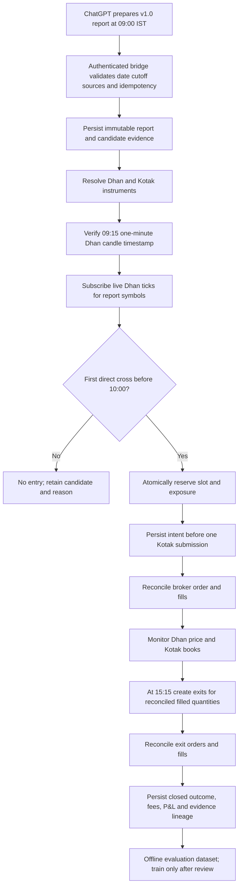

# Live session lifecycle, audit data and model evaluation

## Session flow

## Current implementation and test boundary

`LiveRuntime` handles separate symbols concurrently on the Dhan tick stream. It requires a direct crossing of the 09:15 candle edge; reserves an idempotent per-symbol intent before calling Kotak; reconciles reported fills; and creates a single EOD exit intent per symbol for broker-confirmed filled quantities. A restart reads existing intents and refuses duplicate entry/exit intents. The operator must manually arm each session; service restarts are disarmed. Daily-loss and stop-loss cutoffs are not part of the requested strategy. Fixed position allocation and gross exposure limits still apply.

The mocked lifecycle test drives ten symbols through entry, full broker fills, 15:15 exits and a simulated restart. It verifies intent count and duplicate-exit prevention. It does not place an order or establish that live Kotak responses, fees, partial fills, network recovery or Dhan timestamp behavior match production.

## PostgreSQL storage and remaining audit-data gap

The signal receiver, dashboard and live order ledger use one PostgreSQL database. The ledger records typed prices, quantities, broker state transitions and durable idempotent intents; PostgreSQL transaction advisory locks serialize entry-cap reservations across workers. The existing tables do not yet form a complete joined prediction-to-trade dataset. The current broker book provides gross mark-to-market snapshots, not a complete immutable closed-trade record with exact fees and realized net P&L. Do not train a model from these records until those gaps are closed.

Versioned schema migrations, backups and restore drills remain production follow-up work. Extend the schema transactionally for:

- `research_reports`: immutable complete report JSON, report hash, session, cutoff, receive time, source coverage and producer/run identifier.
- `predictions`: each candidate's direction/rank, evidence IDs and URLs, event facts, generated features, model/prompt version, uncertainty, and the exact information cutoff.
- `price_snapshots`: source, instrument, exchange time and ingestion time for ORB candles, entry ticks and exit ticks.
- `order_intents`, `order_events`, `fills`: unique client tag, retry/reconciliation state, broker order IDs, every partial fill, fees/taxes, and event timestamps.
- `closed_trades`: joined entry/exit fills, signed quantity, realized gross/net P&L, costs, exit reason, unmatched quantity, and reconciliation status.
- `daily_marks`: broker-confirmed open position quantity, quote time/source and unrealized gross P&L snapshots.

The database uses timezone-aware timestamps, numeric money fields, unique constraints on session/symbol/phase, append-only intent events and PostgreSQL advisory locks. Add unique broker fill identity, migration versioning, backups and restore drills before enabling unattended operation.

## Model improvement data

Keep the ChatGPT research report as the original prediction record; never overwrite it with realized outcomes. After sessions close and broker reconciliation succeeds, add separate labels for actual open-to-close return, entry-to-exit return after costs, and whether each candidate's predicted side matched its defined horizon. Keep “no ORB trigger” as a distinct result from a losing trade.

Start with descriptive calibration and walk-forward evaluation. Compare the research selection with simple baselines and include transaction costs, gaps, rejected entries and missing data. Require enough independent sessions and out-of-sample improvement before any learned score can affect selection. Retain prompt/model versions and point-in-time source features to prevent leakage. The stored data can later support evaluation and model training; it cannot prove that training will improve returns.
